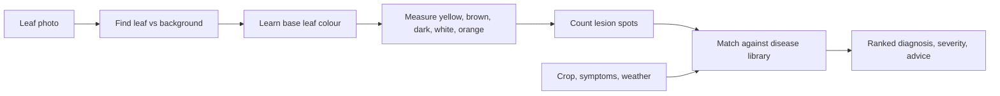

<div align="center">


<br>

**Photograph a leaf. See the disease before it spreads.**

[Features](#-features) · [How it works](#-how-it-works) · [Quick start](#-quick-start) · [Deploy](#-deploy) · [Roadmap](#-roadmap) · [Contributing](#-contributing)

</div>

---

## ✨ Features

| | |
|---|---|
| 🍃 **Any leaf colour** | Separates the leaf from the background and learns the leaf's own base colour, so red, purple and silver leaves work too |
| 🧬 **35+ conditions** | Fungal, bacterial, viral, pest and nutrient problems across common Indian crops |
| 🎯 **Ranked diagnosis** | Top match plus alternatives with confidence, severity and a damage estimate |
| 🗺️ **Detection map** | Colour overlay showing exactly where the damage was found |
| 🌾 **Context aware** | Choose your crop, tick symptoms and recent weather to sharpen results |
| 📚 **Disease library** | Searchable, filterable by severity, with symptoms and advice |
| 🕒 **Scan history** | Saved on-device, with a damage trend, delete and CSV export |
| 🗣️ **Hindi and Marathi** | Translation, read-aloud, and sharing via WhatsApp, email or SMS |
| 🌌 **Futuristic dashboard** | Animated aurora, HUD status strip, neon cards, dark and light themes |
| 🔒 **Private by design** | Photos are analysed in the browser and never uploaded |

## 🧠 How it works



1. **Read the leaf:** the photo is shrunk to 160 px and scanned pixel by pixel.
2. **Match patterns:** measurements are compared with the typical look of each disease. Crop, ticked symptoms and weather adjust the odds.
3. **Advise:** short guidance summarised from ICAR, FAO and state agricultural university advisories.

```
## Result


## 🗺️ Roadmap

- [x] Offline colour and pattern scan for any leaf colour
- [x] Disease library, history, CSV export
- [x] Hindi and Marathi advice
- [ ] Installable offline app (PWA)
- [ ] More languages (Telugu, Tamil, Gujarati, Punjabi)
- [ ] On-device trained model for higher accuracy
- [ ] Optional backend for AI diagnosis on self-hosted sites

## ⚠️ Disclaimer

AgriScan is a **screening aid, not a laboratory test**. Always confirm with your nearest
Krishi Vigyan Kendra or agriculture officer before spraying.

## 📄 License

[MIT](LICENSE)
